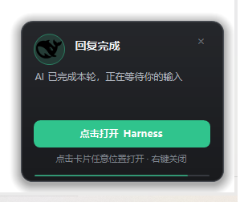
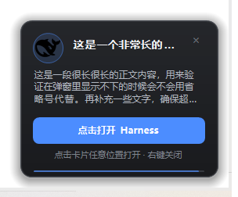

# Attention Notifier — DeepSeek Harness 桌面提醒插件

AI **完成回复**、**向你提问**、**需要审批**、**执行出错**时，在屏幕右下角弹出一张置顶提醒卡片：

- **整张卡片都可点击**（正文和按钮都行）：点击后把 Harness 窗口带到前台，并**自动切换到对应的会话**；
- 按事件类型配色（提问=蓝、审批=琥珀、完成=绿、出错=红），使用 DeepSeek 官方鲸鱼图标；
- 抗锯齿圆角 + 柔和阴影，带提示音、倒计时进度条；同一时间只保留最新一张；
- 右上角 `×` 或右键关闭；不写注册表、不需要管理员权限。



## 安装（DSH 网页/桌面端）

1. 打开 DSH 的 **Plugins → 添加插件**；
2. 在输入框填 GitHub 地址：

   ```
   github:zzjgood/dsh-attention-notifier
   ```

   如果提示不接受短格式，就填完整仓库地址：

   ```
   https://github.com/zzjgood/dsh-attention-notifier
   ```

3. 等待安装完成（`application: applied`），然后**重启一次 DeepSeek Harness**；
4. 之后 AI 提问/需要审批/完成/出错时就会出现提醒卡片。

> 环境要求：Windows 10 / 11；DSH 的 Web GUI profile（`desktop` 或 `web`）；dsh 0.2.x（在 0.2.1-rc.3 上验证）。

## 使用

- 卡片显示在鼠标所在显示器的右下角，10 分钟、15 秒、30 秒不等的自动消失时间；
- 点击卡片任意位置 → 回到 Harness 并定位到提醒对应的会话；
- 点击右上角 `×` 或右键 → 关闭当前卡片；
- 新提醒会替换旧提醒（同一时间只保留一张）；
- 提问/审批卡片停留 10 分钟，完成卡片 15 秒，出错卡片 30 秒。



## 卸载

1. 在 DSH 的 Plugins 页面移除 `@local/attention-notifier`；
2. 删除 `%LOCALAPPDATA%\DeepSeekHarness\attention-notifier\` 目录。

本插件不写注册表、不注册协议、不创建快捷方式，无需额外清理。

## 排查

本机浏览器或 PowerShell 访问：

```
http://127.0.0.1:<当前端口>/attention-notifier/debug
```

返回 `polls`（前端轮询计数）、`lastPollAt`、`hasPending`。`polls` 持续增长说明页面在正常拉取；点击提醒后 `hasPending` 短暂为 `true` 然后变回 `false` 表示会话定位信号已被消费。

## 更新

修改 `package.json` 的 `version`（例如 2.3.2）后提交并推送；在 DSH 里先移除插件再重新安装，或让 agent 用 `plugin_manager` 重新安装。

## 说明

- 仅 Windows；提醒卡片是插件自绘窗口，不进入 Windows 通知中心（Action Center）；
- 会话定位依赖当前 Web 页面在线；侧栏不展示的子会话/子代理会话只能聚焦窗口；
- 卡片上的鲸鱼图标取自 DeepSeek 官方站点，仅用于本插件提醒展示；
- 插件需要用到的运行时脚本（弹窗、聚焦、鲸鱼图）会在安装后自动生成到 `%LOCALAPPDATA%\DeepSeekHarness\attention-notifier\`。

## License

MIT
